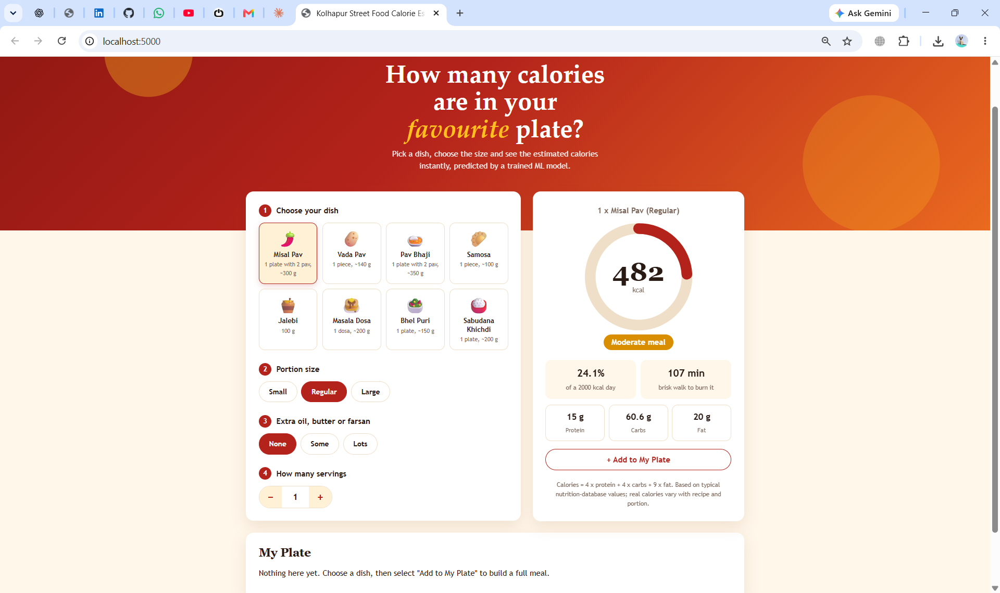
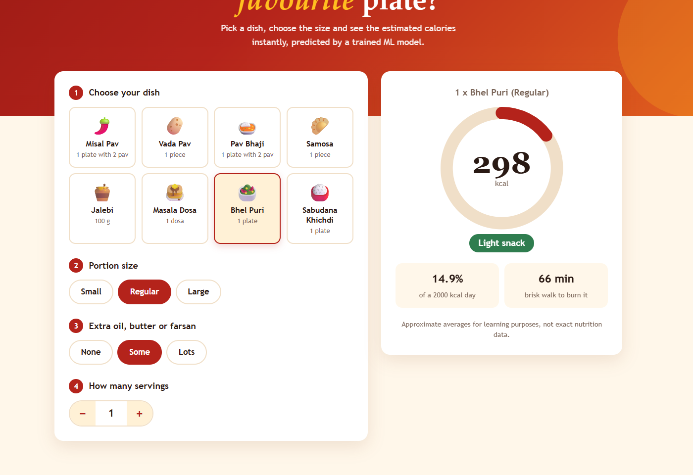
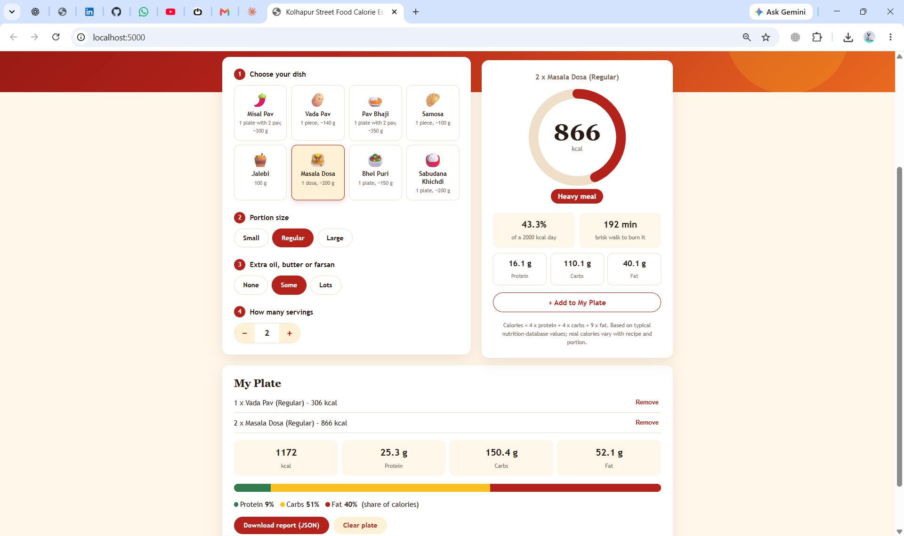
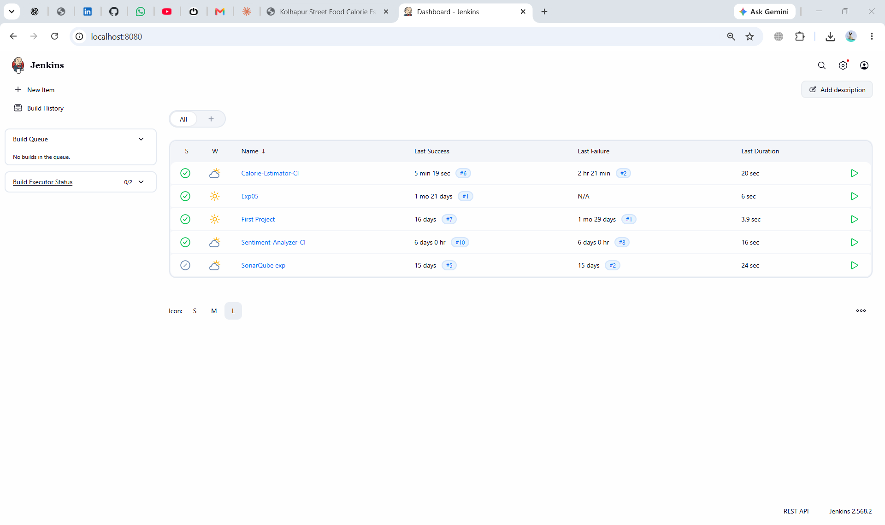

# Kolhapur Street Food Calorie Estimator

A Flask web application that estimates the calories and macronutrients (protein, carbohydrates and fat) of popular Kolhapur street foods using a scikit-learn machine learning model.
Developed for the DevOps ISE-II project using Python, Flask, Git, GitHub, Docker and Jenkins.

## Features
- Web page to choose a dish, portion size, extra oil/butter and number of servings
- ML-based prediction of protein, carbs and fat, with calories calculated as `4 x protein + 4 x carbs + 9 x fat`
- My Plate meal builder with total calories and macros for several dishes
- Macro split bar showing the share of calories from protein, carbs and fat
- Downloadable JSON report for the whole plate
- Automated unit tests using pytest (17 tests)
- Continuous Integration (CI) using Jenkins
- Version control using Git and GitHub
- Docker container for running the app

## Project structure
```
app.py                  Flask application and API routes
model.py                Nutrition data, ML model training and prediction
templates/index.html    Web page
tests/test_app.py       Unit tests
docs/screenshots/       Project screenshots
requirements.txt        Python dependencies
pytest.ini              pytest configuration
Dockerfile              Container image for the app
Jenkinsfile             Jenkins pipeline configuration
```

## Run locally
```
python -m venv venv
venv\Scripts\activate        # Windows  (Linux/Mac: source venv/bin/activate)
pip install -r requirements.txt
python app.py
```
Open http://localhost:5000

## Run tests
```
python -m pytest -v
```

## Run with Docker
```
docker build -t calorie-estimator .
docker run -d -p 5000:5000 --name calorie-app calorie-estimator
```
Open http://localhost:5000

## Versions used
| Tool | Version |
|------|---------|
| Python | 3.13.1 |
| Flask | 3.0.3 |
| scikit-learn | >= 1.5.2 |
| NumPy | >= 2.1 |
| Gunicorn | >= 22.0 |
| pytest | 9.1.1 |
| Git | 2.55.0.windows.3 |
| Docker | 29.8.2 |
| Jenkins | 2.568.2 |

## CI flow
GitHub Push → Jenkins Checkout → Install Dependencies → Run Tests

## Jenkins setup
1. Open Jenkins and select New Item.
2. Choose Pipeline and enter the job name `Calorie-Estimator-CI`.
3. Select Pipeline script from SCM.
4. Select Git, enter the GitHub repository URL, and set the branch to `*/main`.
5. Set Script Path to `Jenkinsfile`.
6. Under Build Triggers, enable Poll SCM with `H/2 * * * *` so new commits start a build automatically.
7. Save the job and click Build Now.
8. Verify that the Checkout, Install Dependencies, and Test stages complete successfully.

## Screenshots
| | |
|---|---|
|  |  |
|  |  |
|  |  |

## Data note
Vada Pav values follow the FatSecret database (1 piece, 140 g). The other dishes use typical published values for a standard serving. Real calories vary with recipe and portion, so results are estimates.

## Future Improvements
1. Add more Kolhapur dishes to the nutrition data.
2. Configure a GitHub webhook to trigger Jenkins builds automatically.
